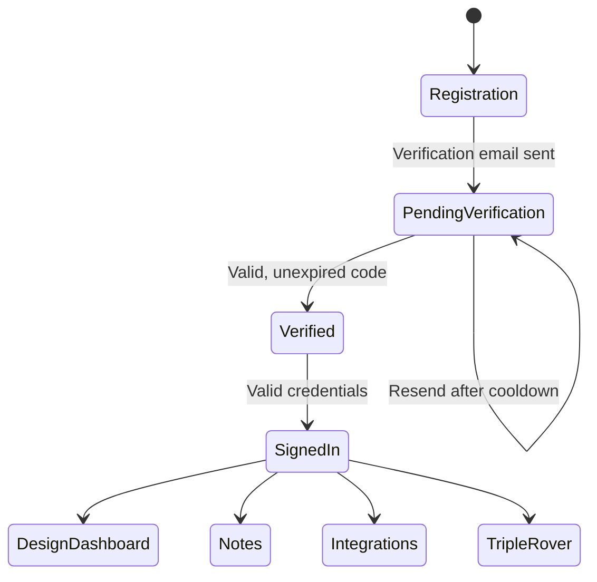

# Accounts and verification

Rover uses account sign-up, email verification, and sign-in before enabling account-specific features.

## Account flow

1. Submit the sign-up form with the requested account details.
2. Rover sends a verification code to the supplied email address.
3. Enter the code on the verification page before its expiry, or use the resend flow if needed.
4. Sign in after verification to access the Design Dashboard, Notes, Settings, and AI integrations.

Sign-in and verification endpoints apply request limits. If an account is not verified, protected features remain unavailable until verification is complete.

  
Email delivery troubleshooting

   

  Check that the deployment's SMTP settings are configured, the application can reach the mail server, and the recipient can receive mail from it. Keep SMTP credentials in private deployment configuration; never put them in the repository or a screenshot.

