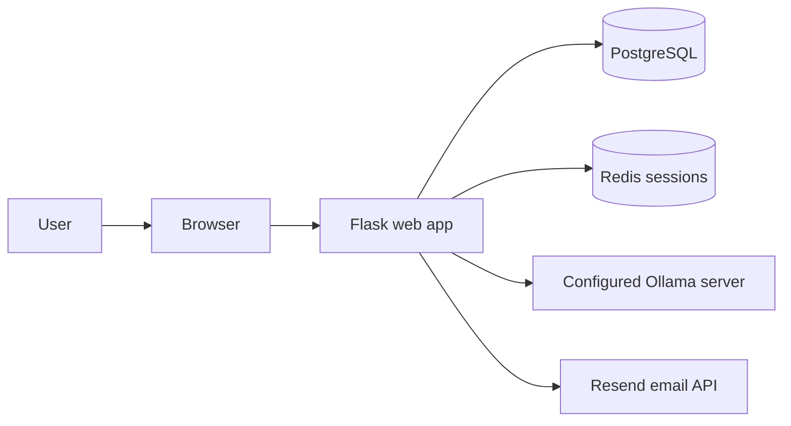

# Getting Started

Rover is a Flask web application. The repository's Docker Compose setup starts the web app, an Nginx HTTPS reverse proxy with Certbot certificate renewal, PostgreSQL, and Redis. Ollama runs separately and is configured as a local service by default.

## Requirements

- Docker Desktop with Docker Compose, or a Python environment for custom development.
- A public hostname whose DNS points to the Docker host, with inbound TCP ports 80 and 443 allowed for Nginx and Certbot's TLS setup.
- An Ollama server and at least one model to use the AI features.
- A Resend API key for account verification email delivery.

## Run with Docker Compose

1. Clone the repository and open its root directory.
2. Create a local `.env` file. Do not commit it.
3. Configure the required values shown below with your own deployment credentials. Generate strong random values for application and database secrets; do not copy sample secrets from documentation.
4. Start the services:

   ```sh
   docker compose up --build -d
   ```

5. Wait for Certbot to obtain a certificate:

   ```sh
   docker compose logs -f certbot
   ```

   After the log reports that Nginx loaded the certificate, press Ctrl+C to stop following logs (the service continues running).
6. Open `https://<ROVER_DOMAIN>`.
7. To inspect application startup output:

   ```sh
   docker compose logs -f web
   ```

Nginx serves the ACME HTTP challenge and redirects other HTTP requests to HTTPS. Certbot obtains and renews certificates for `ROVER_DOMAIN`, then signals Nginx to reload them. DNS must resolve to the host and inbound TCP ports 80 and 443 must reach the proxy. On first startup, Nginx uses a temporary self-signed certificate until Certbot obtains a trusted certificate; do not use the site until issuance succeeds. The web container is not published directly to host ports. PostgreSQL and Redis are provided by Compose. The default Ollama address assumes Ollama is reachable from the Docker host; change it if your topology differs.

### Configuration names

Set these in the local `.env` file. The Compose file requires the values marked **required**:

| Variable | Required | Purpose |
| --- | --- | --- |
| `SECRET_KEY` | Yes | Flask session signing and application secret. Use a strong, private value. |
| `ROVER_DOMAIN` | Yes | Public DNS hostname for the HTTPS reverse proxy. |
| `CERTBOT_EMAIL` | Yes | Contact address for Let's Encrypt certificate notifications. |
| `POSTGRES_PASSWORD` | Yes | Password for the Compose PostgreSQL database. |
| `RESEND_API_KEY` | Yes | Private API key for sending verification emails through Resend. |
| `RESEND_FROM_EMAIL` | No | Verified Resend sender address; defaults to `onboarding@resend.dev`. |
| `OLLAMA_BASE_URL` | No | Ollama server URL; defaults to a host-local Ollama endpoint in Compose. |
| `OLLAMA_MODEL` | No | Default model name; defaults to `llama3.2`. |
| `OLLAMA_API_KEY_ENCRYPTION_KEY` | Recommended for Cloud | Stable encryption secret for saved Ollama Cloud credentials. Keep separate from `SECRET_KEY`. |

Compose sets the database URL, Redis URL, and Markdown storage directory for the container. Avoid copying those generated connection values into public documentation.

<details>
  <summary>Generate a random value for a secret setting</summary>
  <br>

  Run this locally and place the generated output in your private `.env` file. Generate a separate value for each secret:

  ```sh
  python -c "import secrets; print(secrets.token_urlsafe(48))"
  ```
</details>

## First use

1. Create an account and enter the verification code sent to your email.
2. Sign in after verification.
3. Open **Design Dashboard** and add an Ollama API key only if using Ollama Cloud.
4. Open **Settings → Integrations** to select a model that the configured Ollama endpoint offers.
5. Use the Rover AI panel, or choose **Triple Rover Mode** for three separate chat slots.
6. Create and manage Markdown notes from **Notes**.

## Stop services

```sh
docker compose down
```

Compose keeps database and note data in named volumes. Removing volumes is destructive and permanently deletes their contents; only do so when you intend to reset the local installation.

## Development setup

For local development without Docker, install the pinned packages from `requirements.txt`, configure `APP_ENV=development`, and provide a Resend API key, reachable database and Redis services, and an Ollama endpoint. Run database migrations with Flask-Migrate before starting the WSGI application. The Docker Compose workflow is the simplest fully wired setup.


