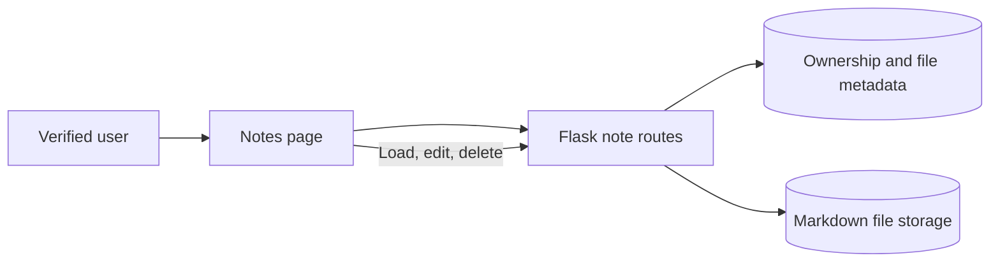

# Markdown Notes

The Notes page provides account-specific Markdown note creation and management.

## Create a note

1. Sign in and verify the account.
2. Open **Notes**.
3. Enter a note name, description, and Markdown content.
4. Save the note.

Names and descriptions are required. Duplicate note names are not accepted. The Notes page supports loading a saved note into the editor, updating it, and deleting it. Notes are listed with pagination.

## Storage and privacy

Note content is stored as Markdown files in the server's configured note-storage directory. The database stores note ownership and metadata used to find the content. The Docker Compose deployment mounts note storage in a persistent volume.

Use the Notes page only for content appropriate for the Rover deployment. Protect backups of both the database and note-storage volume, and do not publish their contents in source control or support requests.

