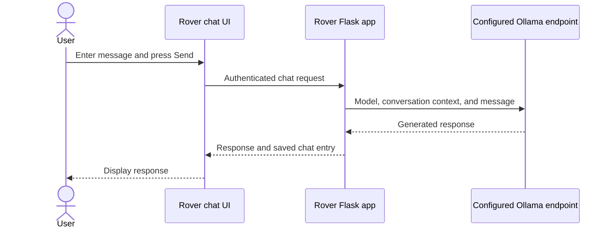

# Ollama integration

Rover uses Ollama for text generation in its single Rover AI panel and Triple Rover agents. Rover does not download models itself; the selected model must be available from the configured Ollama endpoint.

## Configure the endpoint

Set `OLLAMA_BASE_URL` and `OLLAMA_MODEL` in the application's private environment:

- **Local Ollama:** point `OLLAMA_BASE_URL` at the Ollama server reachable by the web app. Local Ollama normally does not require an API key.
- **Ollama Cloud:** production defaults to the official HTTPS endpoint (`https://ollama.com`) when `OLLAMA_BASE_URL` is unset. Save an Ollama API key in Rover. For local development, set `OLLAMA_BASE_URL=https://ollama.com` explicitly to use Cloud.
- **Custom Ollama-compatible endpoint:** configure its URL as appropriate. Rover does not forward saved Ollama keys to local or custom endpoints.

The Docker Compose default targets an Ollama service on the Docker host. Network reachability depends on where Rover and Ollama run; check the URL from the web container's network perspective.

On Render, leave `OLLAMA_BASE_URL` unset to use Ollama Cloud by default, or set it to the endpoint your deployment can reach. Saved Cloud keys are sent only when the configured URL is the official HTTPS `ollama.com` endpoint; they are not sent to local or custom endpoints.

## Add a Cloud API key

1. Sign in with a verified account.
2. Open the **Design Dashboard** and select **API Key**.
3. Give the key a recognizable label, choose **Ollama API Key**, enter the secret, and save it.
4. The saved key becomes active automatically. To switch keys, open **Settings → Integrations**, select a saved key, and choose **Activate selected key**. Use **Deactivate key** to stop using it; Ollama Cloud requires an active key.
5. Rover keeps your current model if available; otherwise, it selects `gemma4:31b` when available, or the first available model. You can choose a different model and save the integration settings.

Rover displays saved key labels, not the secret. Re-enter a key if it needs to be replaced. Configure a stable `OLLAMA_API_KEY_ENCRYPTION_KEY` in the deployment environment for encrypted-at-rest credentials. Keep it private, separate from `SECRET_KEY`, and backed up securely; changing the encryption secret can make existing saved keys unusable.

## Select and use a model

The Integrations page checks models offered by the configured endpoint and saves the selected model for the account. The single Rover AI panel can also have its own chatbot name and model setting. Triple Rover slots each have independent model settings.

The assistant panel shows connection/model status. If it reports the service is unreachable or the model is missing, verify:

- The Ollama service is running and reachable from the Rover web process.
- The configured base URL is correct for the current network/container.
- The model is installed or available on that Ollama endpoint.
- For Ollama Cloud, a valid saved API key is selected.

Drag the panel's height handle or use its arrow keys to resize it. The message field can also be resized by dragging its bottom-right corner or focusing that corner and using the arrow keys.

## Data sent to Ollama

When a user sends a chat message, Rover sends the selected model the message, selected attachments, and relevant conversation history. Do not include secrets or sensitive personal data in prompts or files unless the user and deployment policy permit it.

## Files and working folders

Use **Add text file** in Rover AI to save a UTF-8 text, Markdown, or source-code file. Check saved files to send them with each message; uncheck them to stop sending them. Rover stores up to 20 files per account, each up to 64 KiB, and sends at most 128 KiB of selected file content per message. Delete a saved file when it is no longer needed; ending a chat session does not delete it.

Rover encrypts each saved filename and content in the database with authenticated encryption using `OLLAMA_API_KEY_ENCRYPTION_KEY` (or `SECRET_KEY` if unset). This is encryption at rest, not end-to-end encryption: Rover decrypts selected files to send them to Ollama. Chat messages and model responses are saved as chat history and could contain file excerpts, so deleting an attachment does not remove excerpts from history or backups. Keep the encryption key stable and backed up; losing or changing it makes existing files unreadable.

Under **Chatbot settings and computer permissions**, opt into folder reading or writing and choose a working folder using the browser's permission prompt. Enter a file name and choose **Add folder file to Rover AI** to save an encrypted copy, or save the latest reply to a Markdown file after confirming the write. The original files on the computer are not encrypted by Rover. Folder access is limited to the selected folder and current page; select it again after reloading. The folder picker requires a supported browser and a secure context such as HTTPS.

  
Local Ollama versus Ollama Cloud

   

  Local Ollama usually works without a Rover API key. Ollama Cloud requires an API key saved in Rover. Rover sends saved Ollama credentials only to the official HTTPS Ollama Cloud host; a locally configured or custom endpoint does not receive those saved credentials.

