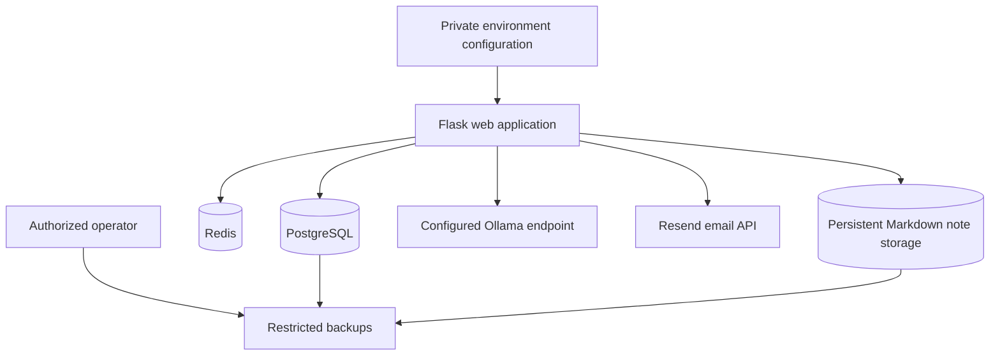

# Operations and privacy

This guide covers safe operational practices for a Rover deployment. It intentionally omits live secrets, private addresses, and sensitive account data.

## Services and persistence

The Docker Compose deployment includes the Flask web app, PostgreSQL, and Redis. Ollama is configured separately, and verification email is sent through Resend using a private API key. PostgreSQL stores application records; Redis supports server-side sessions; Markdown notes use the configured file storage when available and fall back to PostgreSQL if the filesystem cannot be written.

Run database migrations as part of deployment before serving requests. Back up the database and note files together, restrict access to backups, and test restore procedures without exposing production data.

## Protect deployment configuration

- Keep `.env` and private configuration out of Git.
- Generate distinct, high-entropy values for application, database, mail, and encryption credentials.
- Use a stable, private API-key encryption secret and back it up separately using the organization's secret-management process.
- Use HTTPS for public deployments and enable secure cookies; do not expose a development server directly to the public internet.
- Restrict database, Redis, and Ollama network access to the services that need them.
- Rotate credentials if they may have been exposed, and replace saved provider keys when necessary.
- Do not add credentials, private prompts, chat transcripts, or customer data to documentation or public issue reports.

## Data lifecycle

| Data | Typical location | Lifecycle |
| --- | --- | --- |
| Account and application records | PostgreSQL | Retained until removed by an account or deployment data-management process. |
| Single Rover AI messages | PostgreSQL | Deleted when the user ends the active chat session. |
| Triple Rover transcript | PostgreSQL | Cleanup is scheduled after the seven-day window measured from first chat. |
| Markdown note content | Note-storage directory or PostgreSQL fallback | Retained until the note is deleted or its storage is removed. |
| Browser-selected folder access | User's browser page session | Folder handles are held in page memory; Rover does not receive the selected folder handle. |

Retention and backup behavior should be reviewed against the requirements of the organization operating the deployment.

## Runtime checks

Use `docker compose ps` to inspect service state and `docker compose logs` to diagnose startup issues. Do not publish unredacted logs: logs can contain operational details. Investigate service failures through trusted, access-controlled channels.

