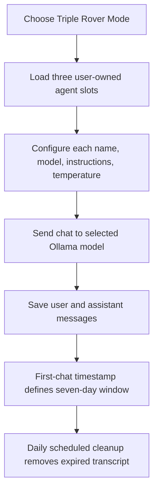

# Triple Rover Mode

Triple Rover Mode is a Design Dashboard view with three separate Ollama chat agents. Each slot can be named and configured independently, and chats can be sent independently to the configured endpoint.

## Open and configure the agents

1. Sign in with a verified account and open **Design Dashboard**.
2. Open the **Rover mode** selector in the Rover AI panel.
3. Choose **Triple Rover Mode** and confirm the prompt.
4. Use **Agent settings** on a slot to set its name, available Ollama model, system instructions, and temperature.
5. Save settings, then send a message in that agent's chat.
6. Choose **Single Rover Mode** in the top navigation selector to return to the Design Dashboard.

Each agent's saved transcript and settings are independent. System instructions are sent as context to that agent's selected model. Keep instructions and prompts free of credentials and other sensitive information.

## Chat history and retention

An agent slot's retention timestamp begins when its first chat is initiated. Its transcript is retained for up to seven days from that timestamp; later messages do not extend the window. A scheduled daily cleanup removes expired messages and the corresponding conversation record. Because cleanup runs once a day, data may remain until the next scheduled cleanup after its seven-day window passes.

## Boundaries

- Triple Rover is limited to three agent slots per account.
- Agents send chat requests to Ollama; they do not execute commands or receive local computer access.
- The agent history retention schedule is separate from the single Rover AI session controls.
- Agent configuration remains available after an expired transcript is cleaned up; a new conversation can start in that slot.

If models are unavailable or chat requests fail, verify the Ollama endpoint and selected model on the Integrations page.
