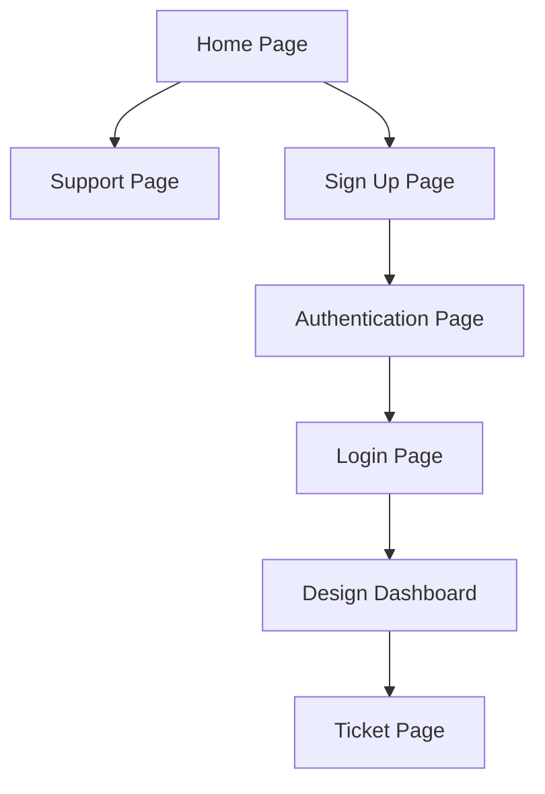

# Rover

Rover is an Ollama-powered AI assistant application built for generating project ideas, notes, application schemas, backend folder structures, and other developer-focused outputs from a local AI workflow.

It is currently under active construction by a solo developer, with a focus on creating a practical local assistant for planning and scaffolding software projects.

## Overview

Rover is designed to help developers capture ideas and turn them into structured outputs such as:

- notes and project summaries
- database and schema suggestions
- backend folder structures
- application architecture planning
- reusable project planning prompts and workflows

The application is intended to run locally and use Ollama as the AI backend, keeping the workflow focused on privacy, experimentation, and rapid prototyping.

## Current Status

Rover is in construction and is being developed by a solo developer. Features are being added iteratively as the project evolves.

## Contributors

- kyedoespython

## Page Flow

## Project Use and Attribution

All rights are reserved by the project owner. No permission is granted to modify, redistribute, or publish derivative versions of this project without prior written authorization. Anyone authorized to contribute or redistribute must receive clear contributor credit, and that credit must remain with the project.