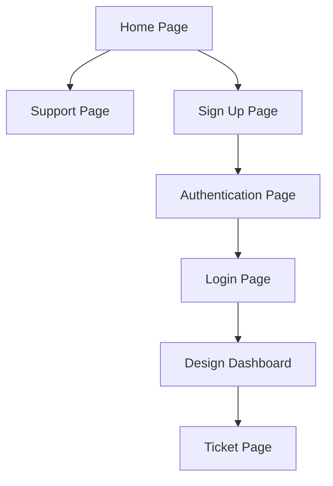

# Rover

Rover is a workspace for notes and designing SQLite database schemas. It is under active construction.

## Overview

Rover provides account management, notes, a SQLite schema designer, and support tickets.

## Frontend

Home, account access, support, settings, notes, and the schema designer render through React. Build the Vite bundle with `npm ci` and `npm run build`; the Docker image builds it automatically. Flask routes, authentication, sessions, and database APIs remain the backend contract.

The retired assistant's historical database tables and encrypted provider keys are not automatically deleted. Operators should retain the previous encryption secret and back up the database before deciding how to remove that data; revoke provider keys with their providers if they are no longer needed. Historical migrations remain so existing deployments can still upgrade. Review autogenerated migrations carefully: they may propose dropping the retired tables and columns.

On the login page, **Remember me for 3 days** keeps that browser signed in for up to three days of inactivity. Without it, the login cookie lasts for the browser session. Redis session records expire after three days of inactivity; no account database migration is required. Resetting the account password invalidates existing logins.

Signed-in users can submit support tickets from **Support**. Tickets are stored in the application's `tickets` database table for operators to review; there is no automatic support email notification or ticket-management interface. Titles are limited to 64 characters and descriptions to 512 characters. Apply database migrations before using this feature.

## Current Status

Rover is in construction and is being developed by a solo developer. Features are being added iteratively as the project evolves.

## Contributors

- kyedoespython

## Page Flow

## Project Use and Attribution

All rights are reserved by the project owner. No permission is granted to modify, redistribute, or publish derivative versions of this project without prior written authorization. Anyone authorized to contribute or redistribute must receive clear contributor credit, and that credit must remain with the project.