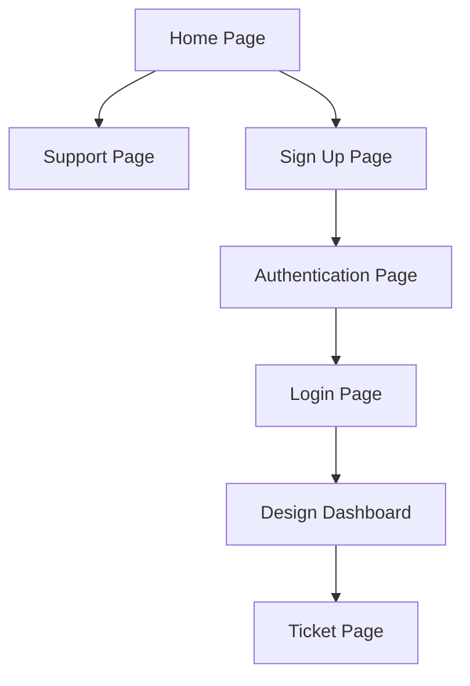

# Rover

Rover is an Ollama-powered AI assistant application built for generating project ideas, notes, application schemas, backend folder structures, and other developer-focused outputs from a local AI workflow.

Project and setup guides are available in the [Docs folder](Docs/README.md), including the [styled documentation landing page](Docs/index.html).

It is currently under active construction by a solo developer, with a focus on creating a practical local assistant for planning and scaffolding software projects.

## Overview

Rover is designed to help developers capture ideas and turn them into structured outputs such as:

- notes and project summaries
- database and schema suggestions
- backend folder structures
- application architecture planning
- reusable project planning prompts and workflows

The application is intended to run locally and use Ollama as the AI backend, keeping the workflow focused on privacy, experimentation, and rapid prototyping.

## Ollama Integration

The assistant connects to Ollama's HTTP API. Configure `OLLAMA_BASE_URL` and `OLLAMA_MODEL` for your setup. Docker Compose defaults to a local Ollama server at `http://host.docker.internal:11434` with the `llama3.2` model. Local Ollama does not require authentication. To use Ollama Cloud, set `OLLAMA_BASE_URL=https://ollama.com`, save an API key from [Ollama API key settings](https://ollama.com/settings/keys) in Rover, and select it under Settings → Integrations. Ollama Cloud's `/api/tags` endpoint supplies the available model list.

Ollama API keys entered in Rover are encrypted at rest and sent as bearer credentials only to the official HTTPS `ollama.com` API. They are never forwarded to local or custom endpoints. Set a stable `OLLAMA_API_KEY_ENCRYPTION_KEY` in the deployment environment, separate from `SECRET_KEY`. If it is omitted, Rover derives the encryption key from `SECRET_KEY`; changing that value makes existing encrypted API keys unreadable. Previously saved hash-only keys must be entered again.

Rover AI appears on the Design Dashboard. Its transcript is stored for the active chat session and deleted when the user ends that session with the red **×** button. Folder access is off by default and requires the user to select a folder in a supported browser. A named Markdown file is loaded into the draft after folder read access is enabled; its content is sent to Ollama only after the user presses Send. Saving an assistant reply requires a separate confirmation and is restricted to a file in the selected folder. Folder handles are kept in page memory, not sent to Rover's server, and command execution is not supported.

Chatbot configuration is stored once per account in `chatbots`, with folder-permission flags in the one-to-one `chatbot_metadata` table. `chatbot_sessions` tracks session start/end, and `chatbot_messages` stores the ordered transcript with cascading cleanup when a session's history is removed.

Triple Rover Mode is available from the Design Dashboard mode selector. It opens three independently named and configured chat slots; each slot has its own model, system instructions, temperature, and transcript. A slot's seven-day history window begins with its first successful chat and is purged by the daily 03:00 UTC scheduler. Agent slots and their metadata are stored in `rover_agent` and `rover_agent_metadata`; transcripts are stored in `rover_agent_sessions` and `rover_agent_messages`. Triple Rover agents only chat with Ollama and do not execute commands or access local files.

## Current Status

Rover is in construction and is being developed by a solo developer. Features are being added iteratively as the project evolves.

## Contributors

- kyedoespython

## Page Flow

## Project Use and Attribution

All rights are reserved by the project owner. No permission is granted to modify, redistribute, or publish derivative versions of this project without prior written authorization. Anyone authorized to contribute or redistribute must receive clear contributor credit, and that credit must remain with the project.