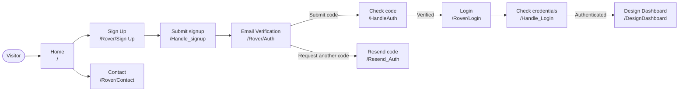

# Rover

Rover is a locally hosted assistant project. The current web application is focused on account signup, email verification, login, and an early-stage design dashboard.

## App Overview

The diagram shows the current page flow. Open it in [Mermaid.ai](https://mermaid.ai/) to view or edit it.

## Pages

| Page | URL | Current contents |
| --- | --- | --- |
| Home | `/` | Introduces Rover and links to signup, login, contact, and the design dashboard. |
| Sign Up | `/Rover/Sign Up` | Signup form for email, username, password, optional phone number, and country. Submission validates account details and starts email verification. |
| Email Verification | `/Rover/Auth` | Form for entering the email verification code, with an option to request another code. |
| Login | `/Rover/Login` | Username and password form. Verified users are signed in and sent to the design dashboard. |
| Contact | `/Rover/Contact` | Basic contact information page. It does not currently contain a contact form. |
| Design Dashboard | `/DesignDashboard` | Early placeholder showing “Your Designs”; design management is not implemented yet. |

## Contributors

- kyedoespython

## Project Use and Attribution

All rights are reserved by the project owner. No permission is granted to modify, redistribute, or publish derivative versions of this project without prior written authorization. Anyone authorized to contribute or redistribute must receive clear contributor credit, and that credit must remain with the project.

This notice records the project's intended terms, but a README cannot technically prevent copying or redistribution. There is currently no license file in the repository; obtain legal advice and add an appropriate license or formal terms if you need enforceable conditions.